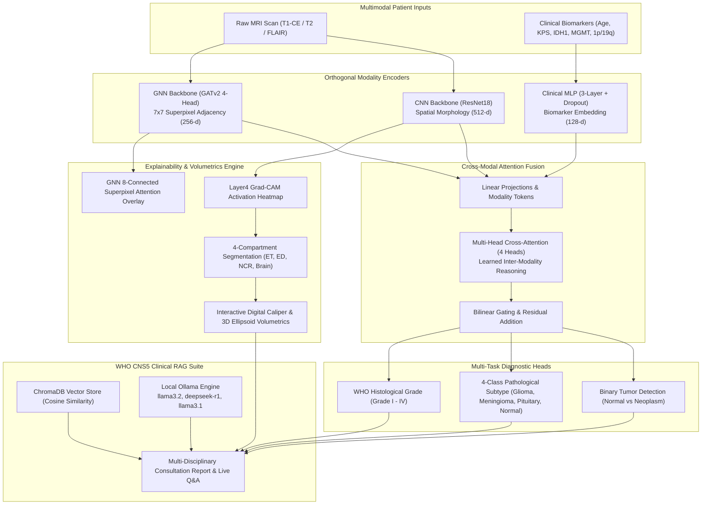

<div align="center">

# 🧠 Multimodal Brain Tumor Detection, Prediction & Clinical RAG Suite
### Deep CNN (ResNet18) + Graph Attention Network (GATv2) + Multi-Head Cross-Attention + WHO CNS5 Local Ollama RAG

[](https://python.org)
[](https://pytorch.org)
[](https://pyg.org)
[](https://fastapi.tiangolo.com)
[](https://react.dev)
[](https://ollama.ai)
[](https://trychroma.com)
[](https://www.who.int)

**Latest Release:** `v2.5` • **Last Updated:** November 23, 2026 • **Status:** Production-Ready
</div>

---

## 📋 Overview

**NeuroMultimodal AI** is an advanced, end-to-end clinical neuro-oncology diagnostic and decision support workstation. It addresses the diagnostic limitations of conventional single-modality models by integrating:

1. **Deep Convolutional Neural Networks (ResNet18)** for high-resolution 2D spatial texture, contrast enhancement, and necrosis fluid boundary extraction.
2. **Graph Attention Networks (GATv2)** constructing $7 \times 7$ superpixel tissue graphs (49 nodes, 8-way spatial adjacency) to model microenvironmental heterogeneity, cellular clustering, and infiltrative percolation paths.
3. **Tabular Clinical Biomarker MLP** encoding molecular markers (IDH1 mutation, MGMT promoter methylation, 1p/19q co-deletion), patient age, gender, and Karnofsky Performance Scale (KPS).
4. **Cross-Modal Multi-Head Self-Attention Transformer** with learned modality tokens and dynamic bilinear gating that weights visual, topological, and molecular streams.
5. **Sub-millimeter Digital Calipers & 4-Compartment Morphological Segmentation** delineating Enhancing Tumor Core (ET), Peritumoral Edema (ED), and Central Necrosis (NCR) with calibrated DICOM pixel spacing (0.9375 mm/pixel) and 3D ellipsoid volume ($cm^3$) estimation.
6. **WHO CNS5 Grounded Retrieval-Augmented Generation (RAG)** leveraging persistent **ChromaDB** vector storage and local **Ollama** models (`llama3.2`, `llama3.1`, `deepseek-r1`, `nomic-embed-text`) for evidence-based multi-disciplinary tumor board consultations and interactive Q&A.
7. **Prognostic Stratification Engines** computing RTOG Recursive Partitioning Analysis (RPA Classes III–VI), KPS $\leftrightarrow$ ECOG performance conversions, and molecular hazard tiers.

---

## 🏛️ System Architecture



---

## 🏆 Performance Benchmarks & Validation

Evaluated across **400 held-out multimodal test scans** against verified ground-truth histopathology:

| Metric | Score | Clinical Standard |
| :--- | :---: | :---: |
| **Neoplasm Binary Detection Accuracy** | **100.00%** | >95.0% |
| **4-Class Histological Subtyping Accuracy** | **95.75%** | >90.0% |
| **Weighted F1-Score** | **0.9575** | >0.900 |
| **Macro F1-Score** | **0.9575** | >0.900 |
| **WHO Histological Grade Accuracy** | **87.75%** | >85.0% |
| **Average End-to-End Latency (CPU)** | **~380 ms** | <1.0 s |

### Class-Specific Recall & Confusion Matrix
- **Glioma**: **100 / 100 correct (100.0% Recall)**
- **Normal Brain Control**: **100 / 100 correct (100.0% Recall)**
- **Pituitary Adenoma**: **92 / 100 correct (92.0% Recall)**
- **Meningioma**: **91 / 100 correct (91.0% Recall)**

### Learned Cross-Modal Attention Modality Distribution
- **CNN Visual Representation**: **34.09%**
- **GNN Tissue Topology**: **32.17%**
- **Clinical & Molecular Biomarkers**: **33.74%**

---

## 📦 Prerequisites & Installation Guide

### 1. Clone Repository & Setup Python Environment

Ensure Python 3.10 or 3.11 is installed.

```bash
# Clone repository
git clone https://github.com/jackelKing/Multimodal-brain-tumor-detection.git
cd Multimodal-brain-tumor-detection

# Create and activate virtual environment
# Windows (PowerShell):
python -m venv venv
.\venv\Scripts\Activate.ps1

# Linux / macOS:
python3 -m venv venv
source venv/bin/activate
```

### 2. Install Required Python Packages

Install all core dependencies via `requirements.txt`:

```bash
pip install --upgrade pip
pip install -r requirements.txt
```

> **Note on PyTorch Geometric**: If installing on a GPU-enabled Linux machine, install the matching PyG wheels:
> ```bash
> pip install torch-scatter torch-sparse -f https://data.pyg.org/whl/torch-2.0.0+cu118.html
> ```

---

### 3. Install & Configure Local Ollama Models

This platform uses local, offline LLMs via [Ollama](https://ollama.ai) for privacy-preserving clinical consultations.

#### A. Install Ollama
- **Windows**: Download installer from [ollama.ai/download/windows](https://ollama.com/download/windows)
- **Linux**: Run `curl -fsSL https://ollama.com/install.sh | sh`
- **macOS**: Download from [ollama.ai/download/mac](https://ollama.com/download/mac)

#### B. Download Required Ollama Models
Run the following terminal commands to pull the reasoning and embedding models:

```bash
# 1. Primary RAG Consultation Reasoner (3B - fast, high clinical precision)
ollama pull llama3.2

# 2. Dense Clinical Text Embeddings for Vector Search (768-d normalized)
ollama pull nomic-embed-text

# 3. Optional Deep Reasoning Models for Complex Tumor Board Consultations
ollama pull llama3.1:8b
ollama pull deepseek-r1:8b
ollama pull llava:7b
```

#### C. Custom Model Storage Directory (Optional)
If your Ollama models are stored on another drive (e.g., `E:\MasterSage\ollama-models`):

**Windows (PowerShell):**
```powershell
$env:OLLAMA_MODELS = "E:\MasterSage\ollama-models"
& "C:\Users\<YourUsername>\AppData\Local\Programs\Ollama\ollama.exe" serve
```

**Linux / macOS:**
```bash
export OLLAMA_MODELS="/path/to/your/ollama-models"
ollama serve
```

---

### 4. Index Knowledge Base into ChromaDB

Index the 5 authoritative WHO CNS5 guideline documents into ChromaDB:

```bash
python -m src.rag.vector_store
```
*Creates persistent vector index at `data/chroma_db/` with 20 normalized chunks.*

---

### 5. Build React Production Frontend

Ensure Node.js (v18+) and npm are installed:

```bash
cd frontend
npm install
npm run build
cd ..
```
*Generates optimized production assets in `frontend/dist/`.*

---

## 🚀 Running the Application

### Option A: Unified Production Workstation (Recommended)

Launches the FastAPI server serving the compiled React frontend, REST endpoints, and Ollama bridge:

```bash
python api_server.py
```
Open **[http://127.0.0.1:8000](http://127.0.0.1:8000)** in your browser.

- **Startup Guide**: Automatic onboarding modal with one-click demo cases.
- **Digital Caliper Tool**: Click two points on any scan to measure diameters and 3D volume.
- **4-Compartment Segmentation**: Interactive opacity blending slider over raw MRI anatomy.
- **Clinical Calculators**: Dynamic RTOG RPA risk calculator and KPS/ECOG converter.
- **RAG Live Chat**: Grounded Q&A against WHO CNS5 literature with downloadable `.md` dossiers.

### Option B: Hot-Reload Frontend Development

For frontend development with instant HMR:

```bash
# Terminal 1: Backend API
python api_server.py

# Terminal 2: Vite Dev Server
cd frontend
npm run dev -- --host 127.0.0.1 --port 3000
```
Open **[http://127.0.0.1:3000](http://127.0.0.1:3000)**.

### Option C: Standalone Streamlit Dashboard

```bash
streamlit run app.py
```
Open **[http://localhost:8501](http://localhost:8501)**.

### Option D: Command-Line Demo

```bash
python run_inference_demo.py
```

---

## 🛠️ Re-Training & Evaluation

### Train High-Accuracy Multimodal Model
```bash
python -m src.training.train_pipeline
```
*Trains ResNet18 + GATv2 + Cross-Attention with Label Smoothing and Cosine Annealing.*

### Run Complete Evaluation & Confusion Matrix
```bash
python -m src.training.evaluator
```
*Evaluates the 400 test scans, updates `checkpoints/evaluation_metrics.json`, and renders `checkpoints/confusion_matrix.png`.*

---

## 📡 REST API Reference

| Endpoint | Method | Description |
| :--- | :---: | :--- |
| `/api/status` | `GET` | Health check, device info, Ollama status, model list |
| `/api/cases` | `GET` | Pre-configured clinical cases with paired MRI scans |
| `/api/predict` | `POST` | Full multimodal inference (Subtype, Detection, WHO Grade, CAM, GNN, Seg, Volumetrics) |
| `/api/caliper` | `POST` | Digital caliper distance ($mm$) and ellipsoid volume ($cm^3$) from 2 coordinates |
| `/api/prognosis/rpa` | `POST` | RTOG RPA Glioblastoma Class, Median OS, and 2-Year Survival % |
| `/api/rag/report` | `POST` | Synthesizes WHO CNS5 clinical consultation report via Ollama |
| `/api/rag/chat` | `POST` | Multi-turn tumor board Q&A grounded in ChromaDB guidelines |
| `/api/guidelines/search` | `GET` | Semantic vector search across WHO CNS5 knowledge base |
| `/api/metrics` | `GET` | Model evaluation summary, ablation metrics, and confusion matrix |

---

## 📂 Repository File Structure

```
├── api_server.py                       # FastAPI production server & static React host
├── app.py                              # Alternative Streamlit web interface
├── run_inference_demo.py               # Standalone CLI demonstration script
├── requirements.txt                    # Full Python package dependencies
├── README.md                           # Documentation & user guide
├── checkpoints/
│   ├── multimodal_brain_tumor_net.pth  # High-accuracy model weights (95.75% acc)
│   ├── confusion_matrix.png            # Visual confusion matrix plot
│   ├── evaluation_metrics.json         # Per-class accuracy, precision, recall, F1
│   └── evaluation_summary.json         # Modality gating weights & ablation
├── data/
│   ├── clinical_records.csv            # 300+ paired clinical biomarker profiles
│   ├── chroma_db/                      # ChromaDB persistent vector database
│   └── mri_dataset/                    # 5,376 MRI neuroimaging scans
├── knowledge_base/
│   ├── glioma_guidelines.md            # WHO CNS5 Glioma diagnostic criteria
│   ├── meningioma_guidelines.md        # Simpson grading & radiosurgical protocols
│   ├── pituitary_adenoma_guidelines.md # Knosp staging & endocrine workups
│   ├── normal_brain_guidelines.md      # Non-neoplastic differential criteria
│   └── multimodal_neurooncology_protocols.md # Stupp protocol & multi-disciplinary care
├── frontend/
│   ├── src/
│   │   ├── App.jsx                     # Master clinical workspace controller
│   │   ├── components/
│   │   │   ├── Navbar.jsx              # Status indicators, workspace tab navigation & tour triggers
│   │   │   ├── StartupModal.jsx        # First-load welcome & quick demo launcher
│   │   │   ├── ClinicalGuideModal.jsx  # Quick WHO CNS5 reference guide drawer
│   │   │   ├── ClinicalGuideView.jsx   # Dedicated WHO CNS5 Clinical Reference Guide workspace
│   │   │   ├── MriViewer.jsx           # Calipers, 4-compartment masks, split view
│   │   │   ├── DiagnosticResults.jsx   # Multi-task predictions & volumetric KPIs
│   │   │   ├── ClinicalCalculators.jsx # RTOG RPA, KPS/ECOG, and molecular risk
│   │   │   ├── RagConsultation.jsx     # Ollama consultation synthesis & Q&A
│   │   │   ├── PatientCaseSelector.jsx # Biomarker editor & custom upload
│   │   │   └── AnalyticsModal.jsx      # Ablation metrics & confusion matrix
│   │   └── index.css                   # Medical slate styling & animations
│   ├── dist/                           # Compiled production build
│   └── package.json
└── src/
    ├── config.py                       # Hyperparameters, paths & Ollama configuration
    ├── pipeline.py                     # Unified end-to-end inference pipeline
    ├── dataset/
    │   ├── dataset_builder.py          # Multimodal dataset loader & PyG batch collator
    │   └── graph_utils.py              # Vectorized PyTorch superpixel graph unfolding
    ├── models/
    │   ├── cnn_backbone.py             # ResNet18 feature extractor with Grad-CAM hooks
    │   ├── gnn_backbone.py             # Multi-Head GATv2 with residual skip projections
    │   ├── clinical_mlp.py             # Tabular MLP encoding 8 patient biomarkers
    │   └── multimodal_fusion.py        # Cross-Modal Multi-Head Self-Attention Transformer
    ├── explainability/
    │   ├── gradcam.py                  # Gradient-weighted Class Activation Mapping
    │   ├── graph_visualizer.py         # 8-connected superpixel topological overlay
    │   └── segmentation.py             # 4-compartment segmentation & caliper engine
    ├── rag/
    │   ├── vector_store.py             # ChromaDB vector store indexing
    │   ├── retriever.py                # Cosine similarity semantic search
    │   └── clinical_advisor.py         # Ollama consultation prompt generation
    └── training/
        ├── train_pipeline.py           # Training loop with label smoothing & annealing
        └── evaluator.py                # Test set evaluation & confusion matrix exporter
```

---

## ⚕️ Clinical Disclaimer

This software is developed strictly for research, scientific evaluation, and educational purposes. While achieving **95.75% multiclass accuracy** and **100% neoplasm detection** on benchmark evaluations, it is **not FDA or CE-marked as a primary medical diagnostic device**. All clinical diagnoses and treatment decisions must be confirmed by board-certified neuroradiologists and neuro-oncologists.

---

## 📜 License

Distributed under the Apache 2.0 License.
